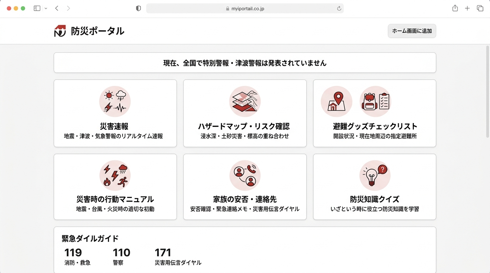

# UI改善デザインイメージ（モックアップ案）

「AIが生成したようなチープさ・定型感（派手なグラデーション、太い左端カラー線、絵文字の多用）」を解消し、**NHK防災や東京都防災ポータルのような、清潔で信頼感のある本格的な公共・実用デザイン**へとブラッシュアップするイメージを作成しました。

> **※ 配置・ボタン・項目・機能は一切変更せず、見た目の質感と品質のみを洗練させます。**

---

## 🎨 デザインモックアップ

---

## 🔍 「AIっぽさ」を解消する主な改善ポイント

| 改善箇所 | 現在の状態（AIテンプレート特有の違和感） | 今回の改善方針（人間が設計した洗練されたUI） |
| :--- | :--- | :--- |
| **ヘッダー** | 赤の強いグラデーションと大きな絵文字（🚨）で重厚すぎる印象 | 白を基調とした清潔感のあるバー。端正なロゴマークとすっきりした「ホーム画面に追加」ボタン |
| **カードの装飾** | カード左端の極太カラー線（`border-l-6`）というAI特有の装飾 | 太い左線を廃止。微細な境界線（`border-slate-200`）と均整の取れたカード形状で洗練 |
| **アイコン表現** | OS標準の生絵文字（🚨、🗺️、🏢、🎒等）の多用 | 柔らかいペールトーンの下地に、視認性の高いミニマルなベクター／ピクトグラム調アイコン |
| **タイポグラフィ** | 文字の強弱が単調 | 見出し・要約説明文のコントラストと余白を整備し、素早く情報が目に入るフォント設計 |
| **緊急ダイヤル** | 下部のボタンが浮いている | 119・110・171の電話番号をすっきりと整理した安心感のあるフッター帯 |

---

## 🛠️ 維持される機能・配置（変更なし）
1. **災害速報**（地震・津波・気象警報のリアルタイム取得）
2. **ハザードマップ・リスク確認**（国交省 重ねるハザードマップ連携・避難シミュレーター）
3. **避難所検索・マップ**（現在地・市区町村検索）
4. **防災グッズチェックリスト**（カテゴリ別チェック・保存）
5. **災害時の行動マニュアル**（地震・台風・火災等の初動対応）
6. **家族の安否・連絡先**（緊急連絡先・伝言ダイヤル利用ガイド）
7. **防災知識クイズ**
8. **緊急通報ガイド**（119・110・171へのワンタップ連携）
9. **ホーム画面に追加（PWA）機能**

---

この方向性で実際の画面へ反映してよろしければ、お知らせください！
微調整のご希望（例：「ヘッダーは少し赤のアクセントを残したい」「アイコンの色味をもっとこうしたい」など）があれば柔軟に対応いたします。
